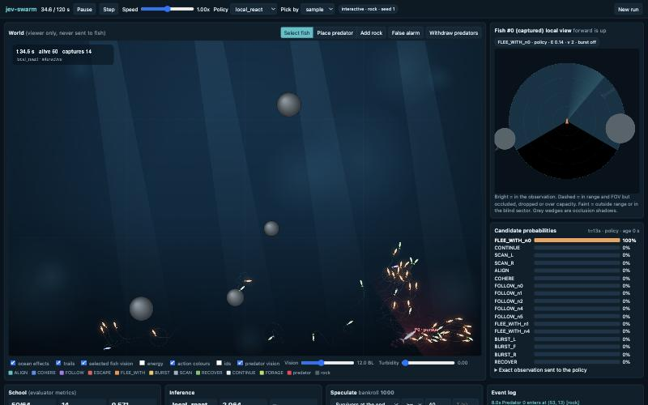
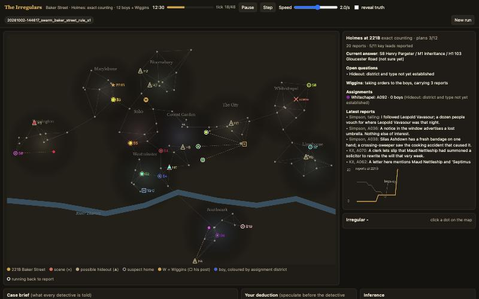

<p align="center">
  
  
  
  
</p>

<div align="center"> <h1>Jev Swarm Games</h1> </div>

<p align="center">
  <a href="docs/project_history.md"><b>📜 Project history</b></a> |
  <a href="holmes/release/blog.md"><b>🕵️ Holmes write-up</b></a> |
  <a href="holmes/trailer/the_irregulars_trailer.mp4"><b>📺 Trailer</b></a> |
  <a href="circuit/docs/benchmark_v3_100seeds_2026-10-08.md"><b>🏆 Circuit benchmark</b></a>
</p>

## Introduction

Jev Swarm Games is a set of collective-behaviour studies and games where **every agent picks its next action with
Jev**, TypeSafe's fast "System One" decision model, from nothing but its own local information. There is no central
planner and no hidden shared state: a fish sees only its vision sector, a scout bee remembers only the sites it has
visited, and an Irregular knows only the leads it has heard. You watch many small, noisy decisions turn into one
collective behaviour, intervene while it runs, and compare the swarm with a single strong reasoner (OpenAI
`gpt-6-astra`), with a strong leader directing a swarm, and with hand-written rules.

Four games share one launcher, one hyperparameter interface, one model client and one key policy:

- **fish**: fish schooling under predator attack (escape waves, fragmentation, confusion effect).
- **honeybee**: honeybee nest-site selection (waggle dances, quorum, misinformation, stubborn scouts).
- **holmes**: *The Irregulars*, a seeded Sherlock Holmes case solved by one detective, by Holmes directing Jev
  street boys, or by a leaderless swarm of 100 Jev Irregulars who lie, forget and vote.
- **circuit**: one injected hardware bug in a pipelined CPU (or a 12-core chip), hunted solo, at Baker Street, or
  by a swarm.

## Contents

- [Introduction](#introduction)
- [News 🔥](#news-)
- [Installation](#installation)
- [APIs](#apis)
- [Launching a game](#launching-a-game)
  - [Customize your settings](#customize-your-settings)
  - [Live controls](#live-controls)
  - [Batch experiments](#batch-experiments)
  - [Tests](#tests)
- [The games](#the-games)
- [Programmatic interfaces](#programmatic-interfaces)
  - [Viewer HTTP API](#viewer-http-api)
  - [Model clients](#model-clients)
- [Repository layout](#repository-layout)
- [Add your own game](#add-your-own-game)
- [Citation](#citation)

## News 🔥

- [2026/10/08] The repo is now **jev-swarm-games**: one launch command and one hyperparameter interface for every
  game (`--preset`, `--set`, `--config`, `--list-params`), and API keys can also come from environment variables.
- [2026/10/08] Circuit v3: a 12-core chip of 1,187 blocks with wire faults, signature probes and scarce bench time;
  100-seed benchmark of all 16 settings. See [the write-up](circuit/docs/benchmark_v3_100seeds_2026-10-08.md).
- [2026/10/05] Holmes release: blog, trailer, and an interactive replay site for 200 cases
  ([holmes/release](holmes/release)).
- [2026/10/04] Holmes 100-case benchmark: **Holmes (gpt-6-astra) + Jev swarm solves 96/100**, against 57 for the
  lone gpt-6-astra genius and 38 for the leaderless Jev swarm; on frame-up cases a clue-counting leader solves 1.
- [2026/10/03] Circuit: CPU debugging with Holmes, Wiggins and Jev Irregulars.
- [2026/09/30] Fish schooling and honeybee nest-site selection simulators with live viewers.

## Installation

Python 3 and one dependency.

```
git clone https://github.com/snyhlx/jev-swarm-games.git
cd jev-swarm-games
python3 -m pip install -r requirements.txt      # numpy
```

Everything else (HTTP server, model clients, viewer) is the Python standard library plus plain JavaScript.

## APIs

Two models are used, through OpenAI-compatible HTTP endpoints:

| Role | Model | Provider | Key source (first found wins) |
|---|---|---|---|
| Agent decisions (every fish, scout, Irregular) | `typesafe/jev-1.13` | OpenRouter System One endpoint | `~/.credentials/openrouter_api_key`, then `$OPENROUTER_API_KEY` |
| Analyst, Holmes leader, the "genius" detective | `gpt-6-astra` | OpenAI | `~/.credentials/llm_api_key` (or `astra_api_key`, `openai_key`), then `$OPENAI_API_KEY` |

Set keys up either way:

```
# Option 1: key files (read at call time, never copied anywhere)
mkdir -p ~/.credentials && chmod 700 ~/.credentials
printf '%s' 'sk-or-...' > ~/.credentials/openrouter_api_key
printf '%s' 'sk-...'    > ~/.credentials/llm_api_key
chmod 600 ~/.credentials/*

# Option 2: environment variables
export OPENROUTER_API_KEY=sk-or-...
export OPENAI_API_KEY=sk-...
```

To point a run at a different key, set the key **source**, never the key: `--set jev_key=/path/to/file` or
`--set chat_key=env:MY_OTHER_VAR`. The launch screen has the same two fields and a **Test models** button.

**Keys are never on show.** Configs, run logs, the launch screen, `/api/schema`, `--print-config` and error messages
only ever hold the key source (a path or `env:NAME`). Key values are read at request time, sent only in the
`Authorization` header, and anything key-shaped (`sk-…`) is masked before it reaches a log or the browser.
`.credentials/`, `*.key`, `.env` and every `runs/` folder are git-ignored.

**⚠️ Cost:** a Jev run makes one request per agent per decision. Every launch screen estimates the request count and
cost before you start, batch runners take `--max-usd` where it matters, and every game has free rule-based policies
(`local_rule`, `rule`, `random`) that need no key at all.

## Launching a game

Every game starts the same way from the repo root, then you open the printed URL:

```
python3 run.py list                      # games, ports, usage
python3 run.py fish                      # http://127.0.0.1:8777
python3 run.py honeybee                  # http://127.0.0.1:8779
python3 run.py holmes                    # http://127.0.0.1:8781
python3 run.py circuit                   # http://127.0.0.1:8783
```

Each game is also a plain Python package, so `cd fish && PYTHONPATH=../common python3 -m jevswarm` takes the same
options.

The browser opens on a **launch screen** with presets and every hyperparameter, grouped by topic, plus model tests and
a cost estimate. Press launch and the **viewer** runs the simulation in real time.

### Customize your settings

All four games follow one hyperparameter contract (`common/swarmcore/params.py`): a typed `DEFAULTS` dict, named
`PRESETS`, a launch-screen `SCHEMA`, a set of `LIVE_KEYS` that may change mid-run, and `coerce(cfg)` which applies
defaults, then the preset, then your values. The command line, the launch screen and the batch runners all go
through it, so a setting has the same name and meaning everywhere.

```
python3 run.py <game> --list-presets                   # named starting points
python3 run.py <game> --list-params                    # every setting: name, type, default, label, (live)
python3 run.py <game> --preset NAME                    # start from a preset
python3 run.py <game> --set key=value [key=value ...]  # override individual settings
python3 run.py <game> --config my_settings.json        # a JSON object of {key: value}
python3 run.py <game> --print-config [...]             # show the resolved config and exit
python3 run.py <game> --port 9000 --host 0.0.0.0       # where the viewer listens
```

Order of precedence: defaults, then `--preset`, then `--config`, then `--set`. Settings given on the command line
become the launch screen's starting values; everything stays editable in the browser. Unknown setting names are
rejected with a pointer to `--list-params`.

Examples:

```
python3 run.py fish --preset two_predators --set n_fish=128 policy=local_react
python3 run.py honeybee --preset close_call --set n_scouts=200 sampling=argmax
python3 run.py holmes --set mode=swarm difficulty=holmesian seed=9
python3 run.py circuit --preset baker_genius --set tier=v3
```

Fish and honeybee call their presets *scenarios* (the setting is `scenario`); holmes and circuit call them presets.
`--preset` works for both.

### Live controls

While a run is live the viewer can pause, step, change speed, switch the policy, inspect any single agent (its exact
observation, candidate actions and the probabilities Jev returned), and make labelled what-if interventions such as
placing a predator, faking a dance, or planting a lie. Every intervention is written to the run log, and runs replay
deterministically from their seed. Run logs go to `<game>/runs/`.

### Batch experiments

Headless experiments use the same setting names:

```
python3 run.py fish batch --policies local_rule jev --seeds 10 --scenario flank --set n_fish=64
python3 run.py honeybee batch --policies local_rule jev --seeds 10 --vary quality_gap=0.05,0.2
python3 run.py holmes batch --mode swarm --policies rule jev --seeds 20 --max-usd 5 --set difficulty=holmesian
python3 run.py circuit batch --list
python3 run.py circuit batch --settings solo_rule,baker_rule_rule --seeds 1-20 --set tier=v3
```

`python3 run.py <game> batch --help` shows each runner's options. Benchmark write-ups and CSVs live in each game's
`docs/` folder.

### Tests

Offline correctness checks (no API calls, no keys) for every game:

```
python3 run.py fish test
python3 run.py honeybee test
python3 run.py holmes test
python3 run.py circuit test
```

## The games

Each game has its own README with the full design, the meaning of every setting, and results.

- [**fish/**](fish/README.md): fish schooling under predator attack. Local vision with occlusion and noise, Jev
  picks from candidate actions (school, flee, follow an escaping neighbour, recover); metrics for survival,
  polarization, fragmentation and escape waves. Package `jevswarm`, port 8777.
- [**honeybee/**](honeybee/README.md): nest-site selection. Scouts inspect cavities, dance, follow dances and sense
  quorum; break it with misinformation, fake dances, stubborn or biased scouts. Package `beeswarm`, port 8779.
- [**holmes/**](holmes/README.md): *The Irregulars*. A seeded London murder (culprit, motive, hideout) with lies and
  frame-ups, solved Solo, at Baker Street (Holmes plus 12 Jev boys) or by a 100-agent Jev swarm with limited range
  and quorum voting. Package `irregulars`, port 8781.
- [**circuit/**](circuit/README.md): CPU debugging. One bug in a 96-block pipelined CPU or a 12-core chip; probes,
  bench drives and fixes under a clock and a spend cap, solo, at Baker Street or as a swarm. Package `cpudebug`,
  port 8783.

## Programmatic interfaces

### Viewer HTTP API

Every viewer serves a small JSON API on its port (all JSON in and out; nothing returns key values):

| Method | Path | What it does |
|---|---|---|
| GET | `/api/schema` | launch-screen schema, defaults, presets, policies, which key sources exist |
| POST | `/api/test` | `{"cfg": {...}}`: one test call to Jev and the chat model |
| POST | `/api/launch` | `{"cfg": {...}}`: start a run (any subset of settings; `coerce` fills the rest) |
| GET | `/api/frame` | the current frame of the live run |
| GET | `/api/stream` | Server-Sent Events: one frame per message while the run is live |
| POST | `/api/cmd` | live control, for example `{"op": "pause"}`, `{"op": "resume"}`, `{"op": "step"}`, `{"op": "stop"}`, `{"op": "set", "key": "speed", "value": 4}` (keys in `LIVE_KEYS`), plus each game's interventions |

Game-specific extras: fish `/api/fish`, `/api/runs`, `/api/predict`, `/api/analyst`; honeybee `/api/scout`,
`/api/predict`, `/api/analyst`; holmes `/api/preview`, `/api/irregular`, `/api/observation`, `/api/guess`; circuit
`/api/preview`, `/api/static`, `/api/agent`, `/api/inspect`, `/api/guess`.

```
python3 run.py honeybee --port 8779 &
curl -s localhost:8779/api/launch -d '{"cfg": {"scenario": "close_call", "policy": "local_rule"}}'
curl -s localhost:8779/api/cmd -d '{"op": "set", "key": "speed", "value": 20}'
curl -s localhost:8779/api/frame | head -c 300
```

### Model clients

`common/swarmcore/llm.py` holds both clients (stdlib only). Pass a key **source**, not a key:

```python
from swarmcore.keys import CHAT_KEY_CANDIDATES, JEV_KEY_CANDIDATES, first_key
from swarmcore.llm import JevClient, LLMClient

jev = JevClient("openrouter", "typesafe/jev-1.13", first_key(JEV_KEY_CANDIDATES))
answers, meta = jev.ask(
    state={"me": {"energy": 0.7}, "visible_predators": [{"bearing_deg": 40, "range_bl": 6}]},
    questions={"action": {"type": "choice", "instructions": "Pick the action most likely to keep this fish alive.",
                          "criteria": {"FLEE": "swim directly away from the predator", "SCHOOL": "stay with neighbours"}}},
)
print(answers["action"]["probabilities"], meta["usage"])

astra = LLMClient("openai", "gpt-6-astra", first_key(CHAT_KEY_CANDIDATES))
print(astra.chat("You are a terse analyst.", "Summarise the run in one sentence.", json_mode=False))
```

Jev answers typed questions (`choice`, `noul` yes/no probability, `score`) about a `state`, rather than chatting.
Errors are raised as `LLMError` with any key-shaped text masked.

## Repository layout

```
run.py                 launcher: python3 run.py <game> [options | batch ... | test]
common/swarmcore/      shared code
    cli.py             the one command line every game uses
    params.py          the hyperparameter contract and coercion
    keys.py            key sources (files, env:NAME) and read_key
    llm.py             JevClient and LLMClient (OpenRouter, OpenAI, TypeSafe)
    web.py             HTTP and Server-Sent Events helpers, redaction
fish/                  jevswarm package, web/, tests/, docs/
honeybee/              beeswarm package, web/, tests/, docs/
holmes/                irregulars package, web/, tests/, docs/, trailer/, release/
circuit/               cpudebug package, web/, tests/, docs/, tools/
docs/project_history.md  decisions, results and open work across all games
```

## Add your own game

1. Create `<game>/<package>/` with `config.py` (`DEFAULTS`, `PRESETS`, `PRESET_KEY`, `SCHEMA`, `LIVE_KEYS`,
   `coerce` built on `swarmcore.params.merge`), `server.py` (a `serve(host, port)` built on `swarmcore.web`) and a
   three-line `__main__.py` calling `swarmcore.cli.app_main`. Copy any existing game's `__main__.py`.
2. Add `web/` for the launch screen and viewer (it reads `/api/schema`), `tests/test_checks.py`, and optionally
   `<package>/batch.py`.
3. Register it in `GAMES` in `run.py` with a free port.
4. Read keys only through `swarmcore.keys` / `swarmcore.llm`, and pass anything you log or send to the browser
   through `swarmcore.web.redact`.

## Citation

```
@misc{jevswarmgames2026,
  title  = {Jev Swarm Games: collective behaviour from many fast local decisions},
  author = {Sonny},
  year   = {2026},
  howpublished = {\url{https://github.com/snyhlx/jev-swarm-games}}
}
```
