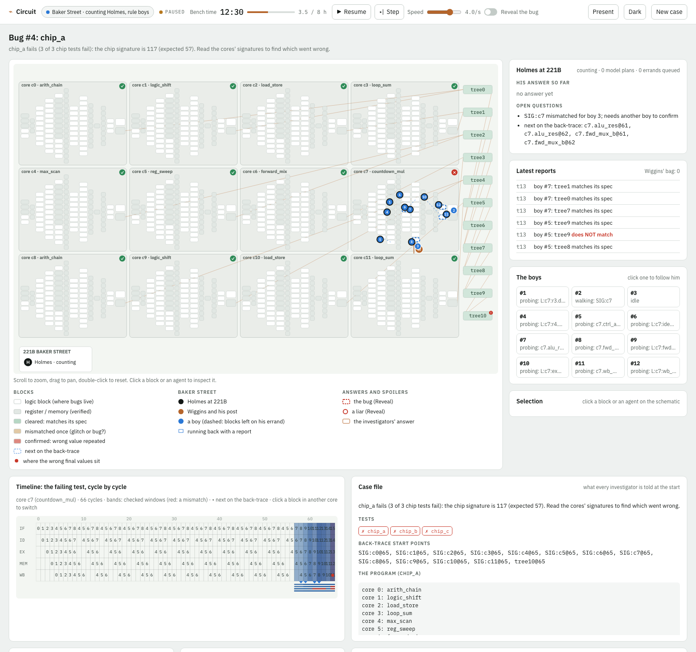
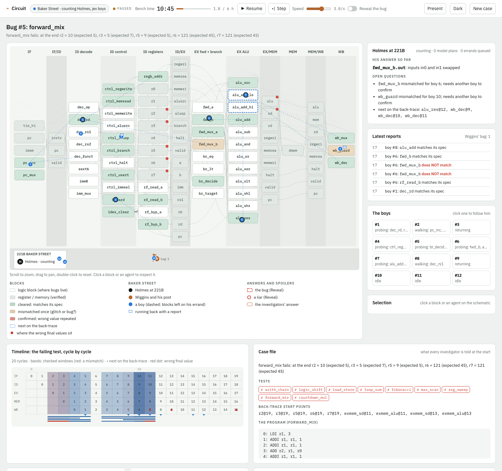

# Circuit: debugging a CPU solo, at Baker Street, or as a swarm

One hardware bug (sometimes two) hides in a small pipelined CPU. A test fails. Who names the broken block, the
signal, the bug type and the fix, within a time limit and a spend cap: one debugger, Holmes directing a dozen street
boys, or 100 Irregulars with no leader? The three families mirror the Holmes detective game in `holmes/`.

```
python3 run.py circuit            # from the repo root, then open http://127.0.0.1:8783
```

## The CPU and the bugs

* **The CPU** (`cpudebug/netlist.py`): 8-bit data, 16-bit instructions, eight registers, 64 bytes of memory and a
  5-stage pipeline (IF, ID, EX, MEM, WB) with EX/MEM and MEM/WB forwarding, a WB-to-ID bypass, a load-use stall and
  branches resolved in EX. It is a pure-Python netlist of **96 blocks**. Each block has a spec (one line of text plus
  an executable reference) and named ports wired to nets.
* **The ISA and tests** (`cpudebug/isa.py`): an assembler, a golden interpreter and nine test programs. The bug-free
  netlist passes all nine.
* **Bugs**: one param of one combinational block is changed. There are four types:
  * **stuck-at** wire;
  * **swapped mux** inputs;
  * **wrong forwarding** / bypass / hazard path;
  * **off-by-one** (adder carry-in, pc increment, branch target, `<` vs `<=`, shift amount, field position, sign bit).

  Registers, memory and the ROM are verified and never broken.

## Hardening (all on by default; the launch screen has an "original easy setting" button)

| Knob | Default | What it does |
|---|---|---|
| `failure_info` | final | Investigators learn only which registers or memory bytes are wrong at the end (or that the test never halted), not the first wrong instruction or its cycle |
| `test_pick` | longest | They get the longest failing test's waveform (up to ~200 cycles). For a double bug, the first failing test whose back-trace reaches both bugs |
| `window` | 2 | Cycles seen by one check |
| `noise` | 0.05 | Each measured row may have one glitched bit, so an innocent block can look guilty once. A real bug reads the same wrong value again; a glitch does not |
| `rare_frac` | 0.4 | Share of bugs that misbehave only when a hash of the block's inputs is 0 mod 3 |
| `double_frac` | 0.2 | Share of cases with a second bug in another block. Each bug alone breaks a test, and both must be fixed |
| `liar_frac` | 0.1 | Bribed boys or lying Irregulars, who clear the real bug and frame one innocent block (coordinated, same cycle, same wrong bit) |
| `liar_defence` | on | Each source counts once; a mismatch needs two sources reading the same wrong value; outvoted or contradicted sources lose trust; plausibility and quorum hygiene in the swarm (below) |
| `deadline_hours` | 6 | The same clock for every family, at 15 case minutes per tick |
| `budget_usd` | 0.75 | Spend cap per case. Above it, agents fall back to their rule |

**Probes.** Every probe costs one tick of bench time, and walking far costs another:
* `check(block, cycle)` shows inputs, measured outputs and spec outputs over a window;
* `drive(block, kind)` tests the block alone with corner, sweep, boundary or random vectors;
* `read(net)` (solo genius only) returns the raw waveform.

The genius's waveform reads are no longer free.

## The three families

**Solo debugger** (`cpudebug/solo.py`): one investigator, 10 probes, the 6-hour clock. Policies:
* `chat`: gpt-6-astra. Each turn it reads the netlist and its notes and asks for up to 4 probes or reads.
* `jev`: Jev picks each probe, and the bug and fix when it accuses.
* `rule`: robust cone tracing. It re-measures any mismatch, then follows the back-trace from the failure.
* `random`.

**Baker Street** (`cpudebug/leader.py`):
* **Holmes** (gpt-6-astra or exact counting) stays at 221B. He reads reports, keeps the notebook, sends errands of 1-3
  blocks at back-trace cycles, and names the bug and fix when sure.
* **Wiggins** (on or off) takes orders to a forward post. He collects reports and runs a batch back when he has three,
  when one has waited two ticks, or when no boy is out. Without him, every boy walks back to 221B.
* **12 boys** (Jev, rule or random) make only local choices: which item next, re-measure a mismatch, or run back. They
  never accuse.
* **Liar defence:** the counting Holmes sends a different boy to confirm every mismatch.

**Swarm** (`cpudebug/swarm.py`): 100 Irregulars, one per block to start, no leader.
* **Each tick**, each Irregular checks its block, moves one wire, shares its newest measurements within radio range
  (2 or 4 wires, graph hops; at most 3 shares taken in per tick; 60 rows remembered), or waits.
* **Closing:** the case closes when 30% hold an identical vote of block plus fault. Without a quorum by the deadline
  the swarm gives no answer.
* **Liar defence:**
  * Plausibility: a claim about a block more than two wires from where the speaker stands is rejected.
  * First-hand contradiction costs the speaker a strike.
  * Trust but verify: an Irregular votes only for a bug it reproduced itself, or that three independent trusted
    sources measured bad.
  * Votes from anyone distrusted by two or more others are struck.
* **Policies:**
  * `rule`.
  * `jev`: Jev picks the next plan (check here, go to a block, share, wait) and the vote. It is asked only at decision
    points: a confirmed suspect appears, its plan ends, or the plan is 12 ticks old.
  * `hybrid`: Jev plans, and the vote is exact.
  * `random`.

## Benchmark (20 seeds per setting, hardened defaults)

| Setting | Solved | Cost / case |
|---|---|---|
| Solo · gpt-6-astra | 14/20 | $0.171 |
| Solo · Jev / rule / random | 3/20 · 3/20 · 2/20 | $0.0004 · free · free |
| Baker Street · gpt-6-astra Holmes, Jev boys / rule boys | 11/20 / 12/20 | $0.143 / $0.137 |
| Baker Street · counting Holmes, Jev boys (no Wiggins) | 11/20 (8/20) | $0.0027 |
| Baker Street · counting Holmes, rule boys (no Wiggins) | 13/20 (12/20) | free |
| Swarm · rule 2 wires / 4 wires | 6/20 / 3/20 | free |
| Swarm · Jev / hybrid / random, 2 wires | 3/20 (13 wrong quorums) / 5/20 / 0/20 | $0.004 / $0.005 / free |

Full table and discussion: [docs/benchmark_20seeds_2026-10-03.md](docs/benchmark_20seeds_2026-10-03.md).
The first, easy version of the game and its 5-seed pilot are in [docs/pilot_2026-10-03.md](docs/pilot_2026-10-03.md).

```
cd circuit
PYTHONPATH=.:../common python3 -m cpudebug.batch --list
PYTHONPATH=.:../common python3 -m cpudebug.batch --settings solo_rule,baker_rule_jev --seeds 1-20 --out docs/x.csv --max-usd 15
PYTHONPATH=.:../common python3 -m cpudebug.report docs/x.csv
```

## Difficulty tiers

The launch screen's Step 2 picks the tier. `tier` in the settings.

| Tier | The chip | What makes it hard |
|---|---|---|
| easy | the 96-block CPU | investigators get the first wrong instruction and its cycle; no noise, no liars |
| v2 | the 96-block CPU | the hardening knobs above (final values only, noise, rare-trigger and two-bug cases, liars) |
| v3 | 12 cores, 1,187 blocks, about 2,500 wires | see below |

**v3: what's on the chip.** 12 copies of the CPU each run their own program. Each core has a signature unit (a MISR
over its write-back and store stream), and an XOR tree folds the 12 signatures into the chip signature.

**What the investigators see.** Only that the chip signature is wrong, plus each core's golden signature. So the
first step is global: read the core signatures (`SIG:c<k>`, one probe each) to find the bad core. A group reads all
12 at once; one investigator needs up to 12 probes.

**Bugs:**
- the v2 block faults, in any core or in the signature fabric;
- **wire faults** on one connection inside a core: `delay` (the receiver sees last cycle's value, a load-timing bug)
  or `convention` (it reads the bus bit-reversed, or a 1-bit signal inverted, an interface mismatch). Both blocks
  meet their own specs, so only a link probe on that wire (`L:c<k>:<receiver>.<port>`) or cross-block reasoning
  (both ends observed, values disagree) can see it.

**Scarce bench.** A bench drive takes 3 ticks and one of 2 shared bench slots, and covers 4 vectors from one input
region. The `trace` region replays what the block saw at a chosen cycle.

**Grading.** Up to 3 fixes; any fix that names an innocent block or wire makes the answer wrong.

**Defaults:** 4-cycle check window, 8-hour clock, solo budget = the clock (32 probes), swarm quorum 12%.

[docs/problem_setup.md](docs/problem_setup.md) explains why v2 needed this: a blind parallel bench sweep solved
80/100 v2 cases. On v3 it solves 0/100 ([docs/bench_sweep_v3_100seeds.csv](docs/bench_sweep_v3_100seeds.csv)).

**v3 results** (100 seeds; [full write-up](docs/benchmark_v3_100seeds_2026-10-08.md)):

| Setting | Fixed |
|---|---|
| Solo gpt-6-astra | 39/82 |
| Baker Street, counting Holmes, rule boys | 24/100 |
| Baker Street, gpt-6-astra Holmes | 19-23/100 |
| Baker Street, counting Holmes, Jev boys | 15-18/100 |
| Solo rule | 7/100 |
| Solo Jev | 1/100 |
| Every leaderless swarm | 0/100 |

The swarms fail because radio does not cross cores, and a quorum must outnumber the liars.



The v3 viewer shows the 12 cores in a grid. Each core carries a signature badge: ? unread, ✓ clean, ! read bad once,
✗ confirmed bad. Suspect wires are drawn in colour. Scroll or click to zoom into a core; zoomed in, blocks are
labelled and wires drawn ([zoomed screenshot](docs/img/v3_viewer_baker_street_zoom.png)).

## The viewer



**Launch screen** ([screenshot](docs/img/launch.png)):
- the three families as tabs, each option card showing its benchmark result and cost;
- presets and every knob;
- a live preview of the failing test, shaded by how much of the back-trace passes through each block;
- a spoiler-free solvability check;
- a cost and time estimate.

**Live view.** The schematic has every block by pipeline stage, with wires (feedback wires dashed). On top of it:
- the suspicion map: cleared, mismatched once, confirmed, next on the back-trace;
- probe flashes;
- a "Reveal the bug" spoiler toggle (bug blocks and liars);
- scroll-zoom and drag-pan;
- click-through on any block (spec, ports, possible faults, a free look at its values) or agent (its notebook,
  errand or vote).

**Per family:**
- [Solo](docs/img/viewer_solo.png): the numbered probe path, the notebook, and what the debugger thinks.
- Baker Street: Holmes's desk at 221B, Wiggins's post and his runs with the bag, boys with dashed lines to the blocks
  left on their errand, runners carrying reports, Holmes's current answer and open questions, the latest reports, and
  the roster.
- [Swarm](docs/img/viewer_swarm.png): 100 dots coloured by vote, radio ripples, and the vote tally against the quorum
  over time.

**Everywhere:** captions, a title card, an end stamp and banner, the pipeline-diagram timeline with the probed
windows, your own guess, pause/step/speed, presentation mode (P), and dark mode
([screenshot](docs/img/viewer_baker_street_dark.png)).

## Files

```
cpudebug/isa.py       ISA, assembler, golden interpreter, the nine tests
cpudebug/netlist.py   96-block netlist, simulator, fault catalogue (rare triggers, several faults), test runner
cpudebug/case.py      seeded case and hardening, probes (check / drive / read) with noise, back-slice, fault fitting, grading
cpudebug/kb.py        the notebook (robust verdicts, liar defence) and helpers shared by every family
cpudebug/solo.py      Solo debugger
cpudebug/leader.py    Baker Street: Holmes, Wiggins, the boys
cpudebug/swarm.py     the leaderless swarm
cpudebug/engine.py    ticks, pacing, budgets, model calls, frames, run logs (runs/, not committed)
cpudebug/server.py    launch screen + live viewer (stdlib HTTP, Server-Sent Events)
cpudebug/batch.py     named benchmark settings, resumable CSV, spend guard
cpudebug/report.py    the benchmark table (Wilson 95% intervals)
tests/test_checks.py  offline checks (no model calls)
```

Keys are read from `~/.credentials/openrouter_api_key` (Jev) and `~/.credentials/llm_api_key` (gpt-6-astra) at call
time and are never logged or written to run logs.
