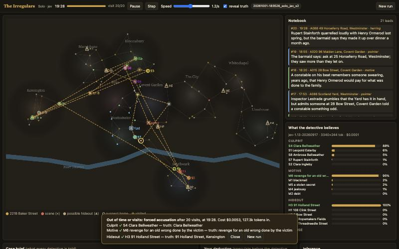
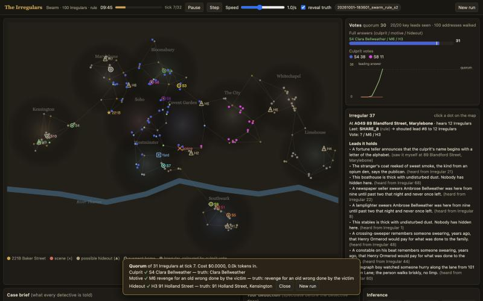

# The Irregulars: pilot, 1 Oct 2026

Matched seeds 1-5, default case settings (100 addresses, 10 suspects, 6 motives, 8 candidate hideouts, each true
key fact at 2 addresses, lie rate 0.1, red-herring rate 0.5). Every case is solvable by counting all its leads.
"Solved" = culprit, motive and hideout all right (Wilson 95% interval). `python3 -m irregulars.batch`.

## Solo: one detective, 20 visits, 12 case hours

| Detective | Solved | Culprit / motive / hideout right | Visits | Accused before running out | Cost (5 cases) | Tokens in / out (5 cases) | p50 latency |
|---|---|---|---|---|---|---|---|
| gpt-6-astra (genius) | **5/5** [0.57, 1.00] | 5 / 5 / 5 | 17.8 | 3 of 5 | **$1.72** ($0.34 per case) | 324k (231k cached) / 11k | 4.5 s |
| Jev | 2/5 [0.12, 0.77] | 2 / 5 / 5 | 18.8 | 0 of 5 | **$0.025** ($0.005 per case) | 584k / 127k | 0.24 s |
| rule baseline | 2/5 [0.12, 0.77] | 2 / 5 / 5 | 20.0 | 0 of 5 | free | - | - |
| random | 0/5 [0.00, 0.43] | 0 / 4 / 0 | 15.4 | - | free | - | - |

Over 20 seeds the rule baseline solves 9/20 [0.26, 0.66] (culprit 13, motive 16, hideout 20); random solves 0/20.

- **gpt-6-astra solved every case**, and in 3 of 5 it accused confidently before using up the budget. Its notes
  are real deductions ("two independent cigar traces and two dark-haired samples identify Henry Pargeter").
  It costs about 70x more than Jev per case.
- **Jev gets motive and hideout every time but the culprit only 2/5.** Picking the culprit means intersecting
  several trait clues with suspect descriptions and discounting a lie, and Jev's culprit answer drifts as leads
  come in. Its "ready to accuse" answer never reached the 0.6 threshold (highest seen: 0.42), so every Jev case
  ended in a forced accusation at the budget or deadline.
- Jev and the rule baseline score the same here (2.4/3). Five seeds cannot separate them.

## Swarm: 100 Irregulars, shouting range 1 km, quorum 30, 32 ticks of 15 min

| Policy | Liars | Solved | Quorum reached | Ticks to close | Plurality parts right at the end | Cost (5 cases) |
|---|---|---|---|---|---|---|
| Jev | 0% | 2/5 [0.12, 0.77] | 4/5 (2 on a wrong culprit) | 22.0 | 2.2 / 3 | **$1.34** ($0.27 per case, 0 fallbacks) |
| reflex rule | 0% | 3/5 [0.23, 0.88] | 3/5 (none wrong) | 20.0 | 2.6 / 3 | free |
| random | 0% | 0/5 | 0/5 | 32 | 0.2 / 3 | free |
| Jev | 15% | 0/5 | 3/5 (all wrong) | 18.2 | - | **$0.95** |
| reflex rule | 15% | 0/5 | 5/5 (all wrong) | 7.2 | - | free |

Jev swarm: 10,932 calls, p50 latency 1.7 s per call with 32 in flight, about 2 s per tick, no timeouts or
fallbacks.

Reflex-rule sweeps (20 seeds, free):

| Setting | Solved | Quorum |
|---|---|---|
| shouting range 0.5 km / 1 km / 2 km | 1 / 13 / 18 of 20 | 1 / 13 / 18 |
| lying Irregulars 0% / 5% / 15% | 13 / 2 / 0 of 20 | 13 / 17 / 20 |
| 10% misinformed + 20% stubborn | 4 of 20 | 13 |

- **Communication range drives everything.** With 0.5 km range the facts never meet; with 2 km the reflex swarm
  solves 18/20, mostly within 10 ticks.
- **Coordinated liars capture vote-counting swarms.** Five liars pushing one consistent false story (made-up
  sightings matching an innocent suspect, a false alibi for the real culprit) produce a wrong quorum in most
  cases. Leads relayed by different Irregulars look independent, so counting corroboration rewards repetition.
  The Jev swarm did no better than the rule here.
- **The Jev swarm commits to wrong answers more readily than the rule.** It reached quorum on a wrong culprit in
  2/5 honest cases; the rule swarm either got it right or stayed undecided. Jev Irregulars almost never walk (0.6% of
  actions); they split between shouting leads (49%) and waiting (50%), so they lean on whatever reaches them.

## Genius vs swarm at roughly equal spend

Per case: gpt-6-astra Solo $0.34, solved 5/5; Jev swarm $0.27, solved 2/5; one Jev detective $0.005, solved
2/5. At this budget, on these cases, one strong reasoner beats 100 cheap ones by a wide margin. The `--fair-to`
cap was not needed: uncapped Jev swarm spend was already below the genius's.

## Spend

| | |
|---|---|
| Pilot batches | Jev solo $0.025 + gpt-6-astra solo $1.718 + Jev swarm $1.343 + Jev swarm with liars $0.953 = **$4.04** |
| Development and viewer checks | about $0.45 (one gpt-6-astra case, a few Jev runs) |

gpt-6-astra is costed from token counts at OpenRouter's list price ($10 / M input, $1 / M cached input, $50 / M
output) because OpenAI's API does not return a cost. Jev costs are as reported by OpenRouter.

## Caveats and next steps

- Five seeds per cell; most intervals overlap. The two clear results are gpt-6-astra Solo 5/5 vs random 0/5, and
  the liar collapse (also seen over 20 seeds with the reflex rule).
- The rule baseline and the reflex rule read structured facts for leads they have collected, so they never
  misread a lead; the models read text only.
- Suggested next runs: 20 seeds of Jev Solo vs the rule (about $0.10); the Jev swarm at 2 km range (about $1.50
  for 5 seeds); a defence against liars (for example, weigh a fact by distinct witness addresses or by
  first-hand sightings only).
