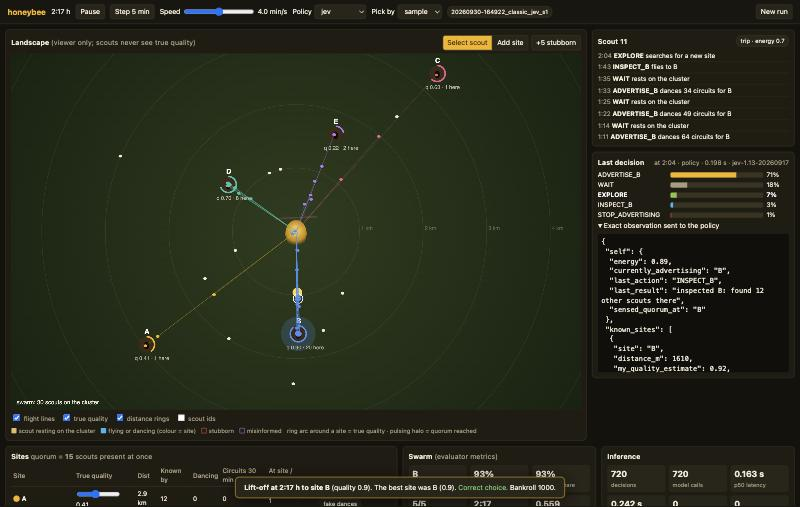

# Honeybee nest-site selection (jev-swarm/honeybee)

A honeybee swarm hanging from a branch has to choose one new home. Scouts inspect candidate cavities, come back and
waggle-dance for the ones they like, and other scouts follow those dances to judge the sites themselves. When enough
scouts are at one site at the same time (the quorum), piping starts and the swarm lifts off. Here **every scout picks
its next action with Jev** from its own memory only, so you can watch many independent, noisy judgments turn into one
collective choice, and then break that process on purpose.



## Quick start

```bash
python3 -m pip install numpy        # only dependency
python3 run.py honeybee             # from the repo root, then open http://127.0.0.1:8779
# or: cd honeybee && python3 -m beeswarm
```

The **launch screen** has scenario presets and every hyperparameter, grouped as Run, Policy, Colony and quorum,
Candidate sites, Scouting, Communication and Scout judgment. It also tests the Jev and chat models and estimates the
number of decisions and the cost. The **viewer** runs in real time. While it runs you can:

- Pause, step 5 simulated minutes, change the speed (0.1 to 160 simulated minutes per second), and switch the policy
  or sampling vs argmax live.
- Watch the landscape: the swarm cluster in the middle, candidate sites with their true quality (a ring arc) and the
  scouts present, scouts flying out and back coloured by site, and waggle dances on the cluster.
- Click a scout to see its traits, its recent actions, its last candidate probabilities and the exact observation
  that was sent to the policy.
- Follow the dance-support chart (circuits per site in the last 30 minutes, dashed lines at each quorum), the
  site table (who knows each site, dancers, scouts present against the quorum line) and the swarm metrics.
- Intervene: drag a site's true quality, add a new site by clicking the map, make 5 scouts believe a site is
  excellent (misinform), inject 5 fake dances, turn 5 scouts stubborn, or move the live knobs (bandwidth, noise,
  follower success, confidence calibration, quorum, attrition, search success). Every intervention is logged and
  replayed.
- Speculate with play money on which site wins, lift-off by hour T, whether the swarm picks the best site, and whether
  it splits. Site odds follow the current dance support, so betting against the crowd pays more.
- Ask the analyst (`gpt-6-astra`) what the swarm is doing. It sees the true qualities and global metrics; the
  scouts never do.

## What a scout sees and can do

Each decision is one Jev `choice` question. The `state` is that scout's observation JSON:

```json
{"self": {"energy": 0.74, "currently_advertising": "B", "last_action": "INSPECT_B",
          "last_result": "inspected B: found 6 other scouts there", "sensed_quorum_at": null},
 "known_sites": [{"site": "B", "distance_m": 1610, "my_quality_estimate": 0.86, "confidence": 0.69, "inspections": 2,
                  "bees_seen_there_last_visit": 6, "minutes_since_inspection": 0, "my_dance_bouts_for_it": 1}],
 "dances_observed_recently": {"window_min": 30, "sites": [
    {"site": "D", "dancers": 2, "dances_seen": 3, "total_circuits": 130, "minutes_since_last_seen": 4}]}}
```

and the `criteria` map the available actions to plain descriptions: `WAIT`, `EXPLORE`, `INSPECT_<site>`,
`FOLLOW_DANCE_<site>` (only for a dance it saw in the last 10 minutes that is still going on), `ADVERTISE_<site>`
(only for a site it inspected and still rates above the dance threshold; the description says how many circuits the
dance will have) and `STOP_ADVERTISING`. Jev returns a distribution over them and the scout samples it with its own
random stream (argmax is also available).

The information boundary: true quality, other scouts' beliefs, how many scouts are at a site right now and the global
dance tally never reach a scout. Site letters are shuffled per seed, so they carry no information about quality.

## Mechanics

| Piece | Rule |
|---|---|
| Sites | `n_sites` cavities at random bearings, 300 to 3,500 m away. Qualities are the best, the best minus the gap, and lower ones. |
| Search | An `EXPLORE` flight lasts 40 min and finds a site with probability `discover_rate`, nearer sites more often. |
| Inspection | The scout flies there (400 m/min), stays about 15 min, and updates a running mean of `quality + bias + noise`. Its confidence rises with repeated inspections. |
| Dance | Circuits are `circuits_max × (estimate − threshold)/(1 − threshold) × (0.5 + 0.5 × confidence)`, minus `dance_attrition` for each earlier bout for that site. At 2.5 s per circuit a 100-circuit dance lasts about 4 minutes. |
| Watching | A resting scout sees about `dance_bandwidth` dances per 10 min, picked in proportion to their circuits. It remembers them for 30 min. |
| Following | The follower finds the advertised site with probability `follow_success`, then inspects it itself. |
| Energy | Flights cost energy per km and resting restores it. Flights it cannot afford are not offered. |
| Quorum | When `quorum_frac × n_scouts` scouts are at one site at once, the scouts there sense it and piping starts. |
| Lift-off | `liftoff_delay_min` later the swarm flies to the site with the most piping scouts. If a second site with a quorum has at least half as many, the run counts as a split. |

The experimental knobs are the ones from the brief. **Misinformation** makes a fraction of scouts start out believing
the worst site is excellent (and keep overrating it). **Noisy scouts** get extra assessment noise. **Biased scouts**
overrate the nearest site. **Communication bandwidth** is how many dances a resting scout can take in. **Group size**
is the number of scouts. **Quality gaps** are the best quality and the gap to the second best. **Stubborn agents**
bypass the policy: they never follow dances and keep advertising the first site they liked, with no attrition.
**Confidence calibration** runs from −1 (underconfident) through 0 (calibrated) to +1 (everyone reports full
confidence, which also makes noisy scouts dance harder).

Scenarios: classic, close call, far best, late best, misinformation, noisy and overconfident, biased, stubborn, low
bandwidth, tiny swarm and hasty (low quorum).

## Policies and cost

| Policy | What it does | Cost |
|---|---|---|
| `jev` | Jev `typesafe/jev-1.13` through OpenRouter, one choice question per decision | about $0.000025 per decision |
| `chat` | `gpt-6-astra` returns a distribution over the same candidates | much slower and costlier; use few scouts |
| `local_rule` | Seeley-style rule: dance for a site right after inspecting it, re-inspect and dance again with fewer circuits, otherwise follow dances in proportion to their circuits, or search, or rest | free |
| `random` | Uniform over the candidates | free |
| `replay` | Replays a recorded run's applied actions | free |

A default run (classic, 100 scouts) makes about 4 decisions per scout per simulated hour and typically lifts off after
about 2 hours. Measured on this setup: 780 decisions, 661 Jev calls (119 decisions had only one option, so no call),
p50 latency 0.18 s, 0 failures, **$0.016 per run**, and about 30 seconds of wall time. The cap is `max_hours` (12 h),
which would cost at most about $0.12.

Each simulated minute, the engine advances the world, then asks every scout that is idle on the cluster for a
decision. Those requests go out together (`concurrency` in flight) and the clock waits for them, so runs are
comparable across policies and replay exactly. A failed or invalid answer falls back to the local rule, and the
fallback count is shown.

## Pilot

On 5 matched classic seeds, Jev picked the best site 5/5 times (local rule 5/5, random 3/5), at about $0.019 per run.
With 15% misinformed scouts it dropped to 3/5 (local rule 2/5), and both decided faster. Five seeds do not separate
the policies. See `docs/pilot_2026-09-30.md`.

## Runs, checks and comparisons

Each run writes `honeybee/runs/<timestamp>_<scenario>_<policy>_s<seed>/` with `config.json` (config, sites, prompt
hash and instruction), `decisions.jsonl` (observation, candidates, distribution, applied action, source, latency,
model version), `events.jsonl` (discoveries, quorums, lift-off, interventions, bets), `metrics.jsonl` (evaluator
metrics every 5 minutes) and `summary.json`.

```bash
cd honeybee
python3 tests/test_checks.py
python3 -m beeswarm.batch --policies local_rule random --seeds 20
python3 -m beeswarm.batch --policies local_rule --vary misinfo_frac=0,0.1,0.2,0.3 --seeds 30
python3 -m beeswarm.batch --policies jev local_rule --scenario close_call --seeds 5    # about $0.02 per Jev episode
```

The batch tool runs matched seeds and reports how often the swarm picked the best site (with a Wilson 95% interval),
the time to lift-off, splits, undecided runs and cost.

The checks cover the observation whitelist, hidden-state invariance (changing true qualities or another scout's state
leaves a scout's observation and candidates byte-identical), labels carrying no quality information, candidate
eligibility and energy gating, no dance for a poor site, dance attrition, following only seen live dances, quorum
followed by lift-off, distribution normalization, stubborn scouts, same seed same run, and exact replay of a sampled
run that includes an intervention.

## Limits of this starter

- The swarm is scaled down (100 scouts, quorum of 15 at once) and one tick is one simulated minute. Real swarms have
  several hundred scouts and often take much longer to decide.
- The local rule is a baseline, not a fitted model of Seeley's data. With the defaults it picks the best site in
  about 70% of classic runs, less often with a small gap, a late best site, misinformation or a tiny swarm.
- Stop signals (head-butting dancers for rival sites) are not modelled yet.
- The analyst is a convenience for the viewer. Its answers are not measurements.
